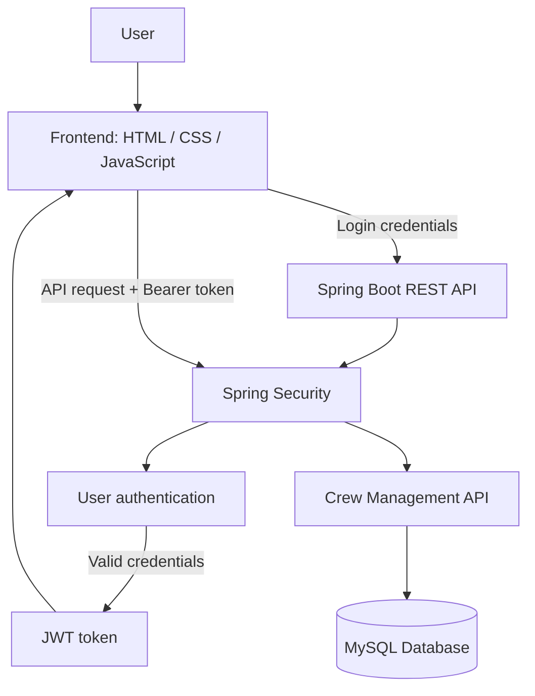

# ✈️ Crew Management System

<p align="center">
  <strong>A full-stack Crew Management System built with Spring Boot, Spring Security, JWT, and MySQL.</strong>
</p>

<p align="center">
  
  
  
  
  
  
</p>

---

## 📌 Table of Contents

- [Overview](#-overview)
- [Features](#-features)
- [Technology Stack](#-technology-stack)
- [System Architecture](#-system-architecture)
- [Crew Data Model](#-crew-data-model)
- [Getting Started](#-getting-started)
- [Configuration](#-configuration)
- [Authentication Flow](#-authentication-flow)
- [API Reference](#-api-reference)
- [Role-Based Access Control](#-role-based-access-control)
- [Testing with Postman](#-testing-with-postman)
- [Project Structure](#-project-structure)
- [Troubleshooting](#-troubleshooting)
- [Roadmap](#-roadmap)

## ✨ Overview

The **Crew Management System** is a full-stack application for managing airline crew information and journey assignments. It provides a Spring Boot REST API, a MySQL database, and a separate HTML/CSS/JavaScript frontend.

The backend uses **Spring Security and JSON Web Tokens (JWT)** to authenticate users. After a successful login, the frontend receives a token and can send it with requests to protected API endpoints.

> [!NOTE]
> Update the endpoint names and project paths in this README to match your current source code before publishing it.

## 🚀 Features

- **Crew records:** manage crew details and journey information.
- **REST API:** connect the frontend to the Spring Boot backend.
- **JWT authentication:** authenticate users through a login endpoint.
- **Password hashing:** BCrypt can store passwords as hashes instead of plain text.
- **MySQL persistence:** save application data in a relational database.
- **Separate frontend:** HTML, CSS, and JavaScript login/UI project.
- **Protected endpoints:** require a valid JWT for authenticated requests.
- **Role-based authorization:** intended to restrict actions according to a user's role; verify each endpoint's rules in `SecurityConfig` before describing this as fully enabled.

## 🧰 Technology Stack

| Layer | Technology |
|---|---|
| Backend | Java, Spring Boot |
| Security | Spring Security, JWT, BCrypt |
| API | REST, JSON |
| Database | MySQL |
| Data access | Spring Data JPA / Hibernate (if configured in your project) |
| Frontend | HTML, CSS, JavaScript |
| API testing | Postman |
| Build tool | Maven (if your project uses `pom.xml`) |

## 🏗️ System Architecture



## 👥 Crew Data Model

The crew record is designed around these fields:

| Field | Purpose |
|---|---|
| `crewId` | Unique crew identifier |
| `crewName` | Crew member's name |
| `dob` | Date of birth |
| `passportNumber` | Passport identifier |
| `passportExpiryDate` | Passport expiration date |
| `flightNumberAssigned` | Assigned flight number |
| `originAirport` | Departure airport |
| `destinationAirport` | Arrival airport |
| `journeyStatus` | Current journey status |

Use validation for required fields and appropriate date formats in your entity/DTO layer. Avoid exposing sensitive passport details in logs or public responses.

## 🏁 Getting Started

### Prerequisites

- Java version supported by your Spring Boot project
- MySQL Server
- Maven, if the backend uses Maven
- A browser
- Postman (optional, for API testing)

### 1. Clone the repository

```bash
git clone <YOUR_REPOSITORY_URL>
cd <YOUR_PROJECT_DIRECTORY>
```

Replace the placeholders with your actual Git repository URL and directory name.

### 2. Create the database

Open MySQL and run:

```sql
CREATE DATABASE crew_db;
```

If your project uses a different database name, use that name consistently in MySQL and `application.properties`.

### 3. Configure the backend

Open `src/main/resources/application.properties` and set your database connection. Example:

```properties
spring.datasource.url=jdbc:mysql://localhost:3306/crew_db
spring.datasource.username=${DB_USERNAME}
spring.datasource.password=${DB_PASSWORD}

# Use the schema strategy appropriate for your project.
spring.jpa.hibernate.ddl-auto=update
```

Set `DB_USERNAME` and `DB_PASSWORD` in your run configuration or environment. Do **not** commit real credentials or JWT signing secrets to GitHub.

If your application currently uses different property names, keep the names expected by your code.

### 4. Run the backend

From the backend project directory:

```bash
mvn spring-boot:run
```

Or run the main Spring Boot application class from your IDE.

The examples in this README assume the backend is available at:

```text
http://localhost:8080
```

Change this if your configured server port is different.

### 5. Run the frontend

Open the frontend folder in your editor and launch its HTML entry page using your preferred local development server. Confirm the JavaScript API base URL points to your backend, for example:

```javascript
const API_URL = "http://localhost:8080/auth/login";
```

If frontend and backend run on different origins, configure CORS in the backend for the exact frontend origin. Avoid using a permissive production CORS policy.

## ⚙️ Configuration

Before running the application, check these settings:

- [ ] MySQL is running.
- [ ] The database exists and its name matches the datasource URL.
- [ ] Database username and password are configured locally.
- [ ] The backend port matches the frontend API URL.
- [ ] The JWT secret is securely configured and sufficiently strong.
- [ ] CORS permits the frontend origin.
- [ ] The login endpoint is permitted without a pre-existing token.
- [ ] Other protected endpoints require a valid JWT.

## 🔐 Authentication Flow

1. The user enters a username and password on the login page.
2. JavaScript sends the credentials to the backend login endpoint.
3. Spring Security verifies the credentials against the user record.
4. The stored BCrypt hash is used for password verification; the raw password should not be stored.
5. If the credentials are valid, the backend returns a JWT.
6. The frontend stores the token for subsequent requests.
7. The frontend sends the token in the `Authorization` header:

```http
Authorization: Bearer <YOUR_JWT_TOKEN>
```

8. The JWT authentication filter validates the token and establishes the authenticated request context.

> **Security note:** `localStorage` is convenient for a learning project, but tokens exposed to JavaScript can be stolen if the site has an XSS vulnerability. For production, review token storage, HTTPS, expiration, logout/revocation strategy, and broader application security.

## 🔌 API Reference

The login path below is based on the frontend API URL used during development. Fill in the remaining paths and request/response examples from your actual controller mappings.

| Method | Endpoint | Purpose | Authentication |
|---|---|---|---|
| `POST` | `/auth/login` | Authenticate a user and return a token | Public |
| `POST` | `/register` or your configured registration path | Register a user, if implemented | Public only if intended |
| `GET` | `<your-crew-list-endpoint>` | Retrieve crew records | Confirm in security config |
| `GET` | `<your-crew-by-id-endpoint>` | Retrieve one crew record | Confirm in security config |
| `POST` | `<your-create-crew-endpoint>` | Create a crew record | Confirm in security config |
| `PUT` | `<your-update-crew-endpoint>` | Update a crew record | Confirm in security config |
| `DELETE` | `<your-delete-crew-endpoint>` | Delete a crew record | Confirm in security config |

### Example: protected request

```bash
curl -H "Authorization: Bearer <YOUR_JWT_TOKEN>" \
     http://localhost:8080/<YOUR_PROTECTED_ENDPOINT>
```

Replace the endpoint placeholder with a real mapping from your controller.

## 🛡️ Role-Based Access Control (RBAC)

Authentication answers **“Who are you?”** Authorization answers **“What are you allowed to do?”**

For example, your application could define roles such as `ADMIN` and `CREW`. These are examples only; use the roles actually stored by your application.

Typical access policy:

| Action | Example policy |
|---|---|
| View crew records | Authenticated users |
| Add or update crew | Admin or authorized operations staff |
| Delete crew | Admin only |

To enforce role-based access:

- Ensure the user's role is loaded into Spring Security authorities.
- Use consistent authority naming, such as `ROLE_ADMIN`, when using `hasRole("ADMIN")`.
- Configure route rules with `hasRole(...)` / `hasAuthority(...)`, or protect service methods where appropriate.
- Test allowed and denied cases with separate users and tokens.

Do not rely on hiding buttons in the frontend as a security control. Authorization must be enforced by the backend.

## 🧪 Testing with Postman

<details>
<summary><strong>1. Test login</strong></summary>

- Choose `POST`.
- Enter your actual login URL, for example `http://localhost:8080/auth/login`.
- Select **Body → raw → JSON**.
- Send the JSON fields expected by your login DTO, for example:

```json
{
  "username": "your_username",
  "password": "your_password"
}
```

- Confirm that successful authentication returns a token.
- Confirm invalid credentials are rejected.

</details>

<details>
<summary><strong>2. Test a protected endpoint</strong></summary>

- Copy the JWT returned by login.
- Open a protected request.
- Select **Authorization → Bearer Token**.
- Paste the token and send the request.
- A valid token should pass authentication if the account has the required authority.

</details>

<details>
<summary><strong>3. Test authorization with different roles</strong></summary>

- Sign in with a user for each configured role.
- Try an endpoint that should be restricted.
- Confirm an authenticated but unauthorized user receives `403 Forbidden`.
- Confirm a missing, expired, or invalid token receives an authentication error such as `401 Unauthorized`, according to your configuration.

</details>

## 📁 Project Structure

A typical structure for this stack may look like the following. Adapt it to match your repository:

```text
crew-management-system/
├── backend/
│   ├── src/main/java/.../
│   │   ├── controller/
│   │   ├── service/
│   │   ├── repository/
│   │   ├── entity/
│   │   ├── dto/
│   │   ├── security/
│   │   └── exception/
│   ├── src/main/resources/
│   │   └── application.properties
│   └── pom.xml
└── frontend/
    ├── index.html
    ├── login.html
    ├── css/
    └── js/
```

## 🧯 Troubleshooting

<details>
<summary><strong>Unknown database</strong></summary>

Create the database in MySQL and ensure the database name in `spring.datasource.url` matches it exactly.

</details>

<details>
<summary><strong>401 Unauthorized</strong></summary>

Check that the token is present, has not expired, is sent as `Authorization: Bearer <token>`, and is validated using the same signing configuration that generated it. Also confirm the request is not accidentally using the wrong API URL.

</details>

<details>
<summary><strong>403 Forbidden</strong></summary>

The request may be authenticated but missing the required role/authority. Check the role stored in the database, the authorities created by your user-loading code, and whether your rules use `hasRole` or `hasAuthority` consistently.

</details>

<details>
<summary><strong>Frontend request blocked by CORS</strong></summary>

Allow the frontend's exact origin in backend CORS configuration. CORS is separate from authentication and does not replace authorization.

</details>

<details>
<summary><strong>Password looks unreadable in MySQL</strong></summary>

A value beginning with a BCrypt-style prefix such as `$2a$` is a password hash, not encrypted text intended to be decoded. Spring Security checks a submitted password against the stored hash using the configured `PasswordEncoder`.

</details>

## 🗺️ Roadmap

- [ ] Complete and verify role-based access control.
- [ ] Add validation for crew and user inputs.
- [ ] Add consistent global exception handling.
- [ ] Add automated tests for controllers, services, and security rules.
- [ ] Document exact API endpoints and sample responses.
- [ ] Deploy the backend, frontend, and database with environment-based secrets.
- [ ] Add screenshots or a short demo GIF.

## 🤝 Contributing

1. Fork the repository.
2. Create a branch for your change.
3. Make and test your changes.
4. Open a pull request with a clear description.

## 📄 License

Add a license if you intend to distribute this project publicly. Until one is selected, do not assume the repository is licensed for reuse.

---

<p align="center">
  <strong>Built as a full-stack learning project using Java, Spring Boot, JWT, and MySQL.</strong>
</p>
